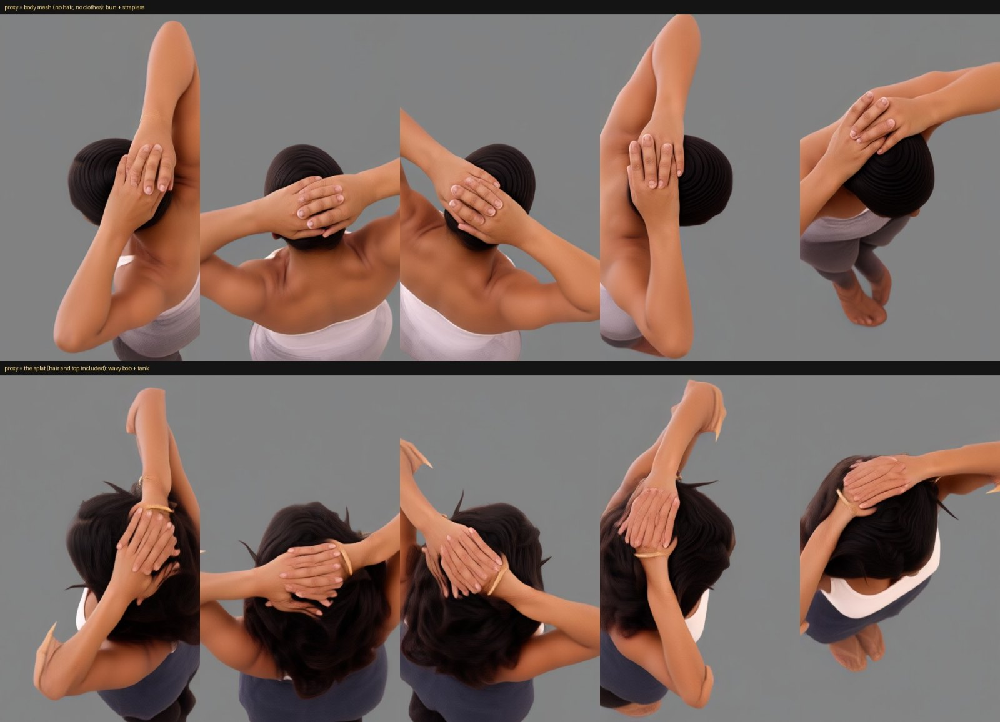
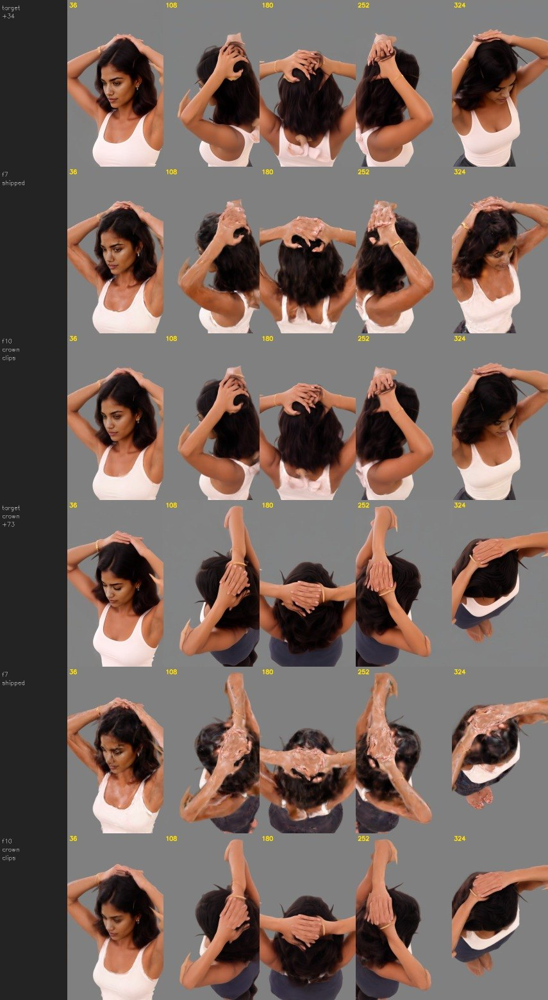
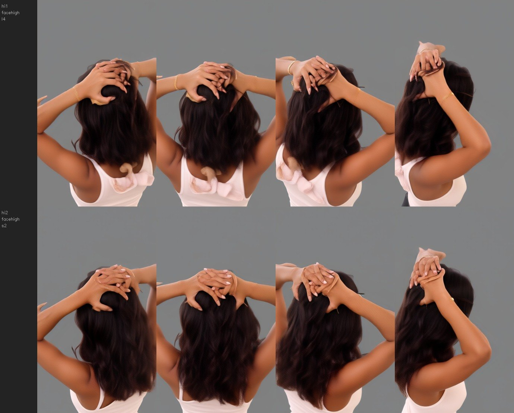
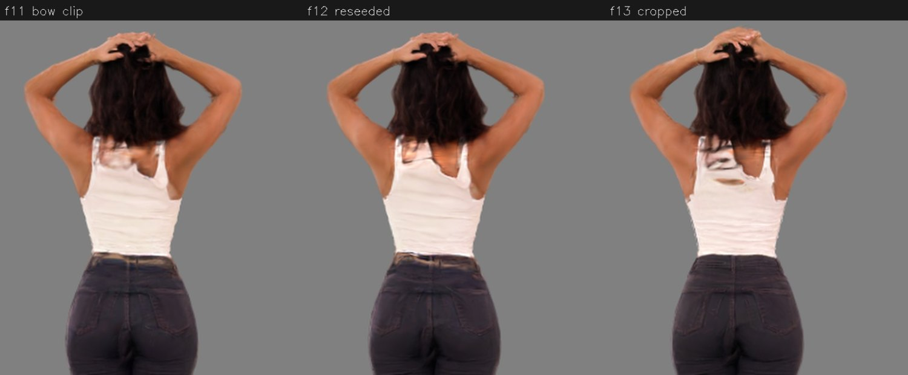

# The off-angle face: diagnosis, fix, and how it was measured

**Status:** 2026-09-20, complete. Written for the paper's method and results sections. The shipped
configuration is arm **F5**, and it is what `run_image_to_splat.bat` runs by default.
**Run:** `output/pacgs/test-image/r1`, subject `test-image`, three generated clips (body orbit, head
close-up, rising orbit), Wan 2.2 Fun-Control A14B, Lightning 4-step, 81 frames per clip at 480×832.
**Companion documents:** [pacgs_results_sprint1.md](pacgs_results_sprint1.md) (the orbit-video method),
[pacgs_quality_next.md](pacgs_quality_next.md) (what is planned next).

## 1. Summary

Once the training views came from one calibrated video instead of a dozen separately drawn images, the
three mechanisms the pipeline had accumulated to cope with *disagreeing* views became the main source
of face artefacts. Removing them, and rebalancing which frames the trainer spends its steps on,
improved every measure of the face away from the front:

| | Agreement with the close-up frames | Detail vs those frames | Speckle |
|---|---|---|---|
| Before (baked photo layer, mesh face priors) | 25.4 dB | 0.71× | 1.09 |
| After (layer off, priors off, close-ups boosted, per-kind anti-aliasing) | 32.2 dB | 0.67× | 0.83 |

The rest of the splat did not pay for it: photo fidelity at viewer size rose from 36.08 to 36.83 dB and
overall sharpness from 12.93 to 14.45, with floaters unchanged at 0.018%.

A speckle score above 1.0 means the fine-grained error is *larger than the real fine detail in the
target frame*: the layer was contributing more wrong detail than right detail. The observer report that
started this ("the good face is behind a noisy layer, and shows through only from the front") turned out
to be an accurate description of the mechanism.

The general lesson, and the one worth putting in the paper: **when the multiview data becomes
self-consistent, the priors introduced to paper over inconsistency stop being free and start doing
harm.** They must be re-examined as a group, not inherited.

## 2. Symptom

Close-ups of the reconstructed head looked correct from the photo's viewpoint and visibly degraded at
every other angle: dark mottling over the cheeks, jaw and forehead, strongest between 20° and 70° off
frontal, and a general impression of a good face seen through a dirty layer.

## 3. What the pipeline was doing, and why

Three mechanisms had been added while the training views were Qwen-generated stills that disagreed with
each other (see `quality_plan.md`, the 2026-09-19 sprint):

1. **A baked photo layer** (`i2g/priors.py: bake_face`). After training, the face core is replaced by
   one flat Gaussian per photo pixel, unprojected onto the body mesh's face surface at the mesh's depth
   (disc width 0.55 of the pixel footprint, thickness 0.2 of the width, opacity 0.99), and the splat's
   own Gaussians from 2 cm under the surface to 0.8 cm above it are deleted. Introduced because the
   generated faces disagreed with one another; it raised face identity from 0.34 to 0.52 at the time.
2. **Mesh-face priors during training**: an expected-depth loss pulling face Gaussians onto the mesh's
   face (`face_depth_weight`), a 2 mm shell they are projected back onto every step (`FaceShell`), and
   a colour-weight suppression that let the photo own the face core in generated views
   (`face_weight = 0`).
3. **Uniform view sampling.** Every non-photo frame received the same share of training steps.

Each was justified by measurements taken when the views were inconsistent. None was re-examined when
the views changed.

## 4. Diagnosis

### 4.1 Method

The head close-up clip provides something the earlier pipeline never had: a set of images of the face
from all around, at a useful size, with exact cameras. That makes a direct test possible — **render the
reconstruction from the close-up clip's own cameras and compare with the frame that was generated for
that camera**. Implemented as `pacgs facecheck` (`pacgs/facecheck.py`), reporting per angle:

- **psnr** — masked agreement with the generated frame, inside the face region (the mesh face region
  where the face is visible, otherwise the subject matte).
- **sharp** — mean |high-pass| of the render divided by that of the frame; 1.0 means the render carries
  as much fine detail as its target.
- **speckle** — mean |high-pass of (render − frame)| divided by the frame's own |high-pass|. Fine-grained
  error with no counterpart in the target. This is the number that captures the artefact.
- **arcface** — identity against the photo where a face is detected.

Ten cameras at 36° intervals, so a front-only score cannot hide an off-angle failure.

### 4.2 Evidence

The trainer already exports the splat from immediately before the bake (`character_unbaked.ply`), so
the layer could be isolated with no retraining.

| Model | psnr | sharp | speckle |
|---|---|---|---|
| `p1_all_fw03` (baked) | 25.45 | 0.707 | **1.087** |
| same splat, unbaked | 28.85–30.66 (see §6) | 0.60–0.64 | 0.88–0.95 |

Removing the layer raised agreement by 3–5 dB and brought speckle below 1.0. The visual comparison
(`report/facecheck/facecheck.jpg`, and the zoomed head strip) shows mottling in the baked renders at
36°, 72°, 288° and 324°, and clean skin in the unbaked ones at the same cameras.

### 4.3 Mechanism

Established by measurement: the layer is the source, it adds more wrong high-frequency detail than the
frames contain, and the effect is minimal at the photo's viewpoint and maximal away from it.

The likely mechanism, part inference:

- The layer is pinned to the **body mesh's** face surface, while the rest of the face follows the
  **trained** geometry. The two agree where the photo camera looks (the layer was built by unprojecting
  along that camera's rays) and separate in parallax elsewhere. The mesh's face needed a 2.7 cm
  alignment push to fit the generated views at all (`priors.align_face`), so a residual mismatch of
  millimetres is expected.
- Discs on surfaces grazing to the photo camera are stretched by 1/cos(tilt), up to 5× at the
  `max_tilt_cos = 0.2` limit. A single photo pixel then covers a large patch of cheek, which reads as a
  blotch from a viewpoint that sees that patch face-on.
- The splat's own Gaussians under the patch are deleted, so nothing backs the layer where it is sparse.

A sweep over the disc parameters (width 0.55→1.2, thickness 0.2→0.7, deletion on/off, on the same
trained splat) moved face-grid identity between 0.52 and 0.69 but did not remove the artefact: wider,
thicker discs blur the photo detail without fixing the parallax mismatch. The layer is the wrong
mechanism, not a mistuned one.

## 5. The three changes

**(a) Drop the baked layer.** `face_bake = False` whenever the head close-up clip is in the training
set. The photo detail is no longer pasted on; it arrives through the close-up frames, which were
themselves generated starting from a crop of the native-resolution photo.

**(b) Drop the mesh-face priors.** `face_shell = False`, `face_depth_weight = 0`, `face_weight = 1.0`.
The face is no longer constrained to an approximate mesh surface, and the close-ups contribute their
colours in full. These priors existed to stop disagreeing views from smearing the face into a cloud;
with a consistent clip they only prevent it from matching its own training data.

**(c) Rebalance the training steps.** Two parts:
- **Per-view sampling shares** (`i2g/splat.py`: a record may carry `weight` and `share`;
  `pacgs/dataset.py: merge(..., boost)`; `--boost clip=N`). With three clips of 79 frames, each close-up
  frame previously received about 47 of 15,000 steps. The close-ups are now weighted 3×.
- **Anti-aliasing where it is needed.** `multiscale` (random zoomed-out steps) was added so a splat
  fitted to the 1866×2799 photo does not alias at normal viewing sizes. Applied to 480×832 video frames
  it only blurs them, so it is now per frame kind (`multiscale_video = 0.1`).
- The orbit pass also trains longer than the earlier passes (20k iterations; `orbit_iterations`).

**Where this lives:** `i2g/orbit_stage.py` applies (a)–(c) automatically when `face` is among the
camera rigs, unless the operator overrode the setting; `image_to_splat.py` carries `orbit_iterations`
per preset.

## 6. Results

### 6.1 Face, measured against the close-up frames (10 cameras, `pacgs facecheck`)

| Arm | Changes | psnr ↑ | sharp → 1 | speckle ↓ | arcface ↑ |
|---|---|---|---|---|---|
| `p1_all_fw03` | baked layer, priors on, `face_weight` 0.3 | 25.45 | 0.707 | 1.087 | 0.376 |
| `f1_nobake` | no bake, priors on, `face_weight` 1.0 | 28.85 | 0.642 | 0.948 | 0.446 |
| `f2_free` | no bake, no priors | 30.66 | 0.600 | 0.882 | 0.441 |
| `f2_recolour` | `f2_free` + photo recolour (§7) | 27.92 | 0.516 | 0.914 | 0.283 |
| `f3_boost` | `f2_free` + close-ups ×3 | 31.68 | 0.610 | 0.854 | 0.451 |
| `f4_boost_sharp` | `f3_boost` + `multiscale` 0.2 + 20k | 31.76 | **0.677** | 0.847 | 0.448 |
| **`f5_msvideo`** (shipped) | `f3_boost` + per-kind multiscale + 20k | **32.24** | 0.665 | **0.834** | **0.467** |

### 6.2 The rest of the splat (the v2 harness, unchanged)

| Arm | Photo dB (canvas) | Photo dB (native) | Face grid (mean / worst) | Floaters % | Sharpness | Gaussians |
|---|---|---|---|---|---|---|
| `p1_all_fw03` | 36.08 | 35.25 | 0.642 / 0.407 | 0.016 | 12.93 | 358k |
| `f1_nobake` | 37.24 | 35.46 | 0.525 / 0.290 | 0.017 | 12.90 | 353k |
| `f2_free` | 37.37 | 35.51 | 0.523 / 0.237 | 0.016 | 12.67 | 336k |
| `f3_boost` | 36.26 | 35.61 | 0.532 / 0.266 | 0.017 | 12.98 | 424k |
| `f4_boost_sharp` | 34.92 | **37.20** | 0.499 / 0.253 | 0.019 | 14.42 | 535k |
| **`f5_msvideo`** (shipped) | **36.83** | 34.55 | 0.506 / 0.241 | 0.018 | **14.45** | 426k |

### 6.3 Two metric lessons worth reporting

**Identity scoring alone chooses the artefact.** Face-grid ArcFace ranks the baked layer highest
(0.64–0.69) and the clean reconstruction lowest (0.52), because it measures identity, not artefacts,
and the layer is literally the photo's pixels. Had we optimised that number, we would have shipped the
speckled face, which is what happened. Artefact-sensitive, multi-angle measurement against the training
frames is what exposed it.

**One number can hide a trade.** Cutting the zoom-out augmentation globally (F4) raised
native-resolution photo fidelity (35.25 → 37.20 dB) and overall sharpness (12.93 → 14.42) while
*lowering* viewer-size photo fidelity by 2.5 dB, i.e. aliasing at ordinary viewing sizes. Applying it
per frame kind (F5: keep it for the native-resolution photo, drop it for the 480p video frames)
recovered viewer-size fidelity (36.83 dB) and kept the sharpness (14.45), while also giving the best
face numbers of any arm. That is the shipped configuration. The remaining cost is native-resolution
photo fidelity, 34.55 dB against F4's 37.20: worth revisiting if anyone renders the splat at the
photo's own resolution.

## 6.4 Round 4: the face from above and below

Once the speckle was gone, the remaining face defect was elevation. Face-grid identity on `f5_msvideo`
fell from 0.63 at eye level to **0.30 at 30° above**, because the head close-up clip was a single ring
at the photo's height: the face had no close-up coverage from any other elevation.

**Two more clips**, same zoom and head tracking, but changing elevation as they orbit and pivoting
about the head so it stays the same distance away: `face_up` rises to +30° over the first quarter turn,
`face_down` dips to −20°. Both still start at the photo's camera, so frame 0 remains an exact crop of
the native-resolution photo.

Scored at each clip's own cameras (`pacgs facecheck`, three clips, 30 cameras in total):

| Splat | Clip | psnr ↑ | sharp | speckle ↓ | arcface ↑ |
|---|---|---|---|---|---|
| `p1_all_fw03` (baked) | eye level | 25.45 | 0.707 | 1.087 | 0.376 |
| | from above | 19.13 | 0.736 | 1.224 | 0.418 |
| | from below | 18.71 | 0.694 | 1.196 | 0.431 |
| | **all** | **21.10** | 0.712 | **1.169** | 0.406 |
| `f5_msvideo` (one ring) | eye level | 32.24 | 0.665 | 0.834 | 0.467 |
| | from above | 19.62 | 0.762 | 1.207 | 0.305 |
| | from below | 20.22 | 0.666 | 1.140 | 0.361 |
| | **all** | **24.03** | 0.698 | **1.060** | 0.381 |
| **`f7_faceball30`** (three rings, 30k) | eye level | 28.87 | 0.619 | 0.932 | 0.458 |
| | from above | 28.32 | 0.648 | 0.919 | **0.553** |
| | from below | 28.40 | 0.618 | 0.885 | 0.448 |
| | **all** | **28.53** | 0.628 | **0.912** | **0.479** |

Face grid (the v2 harness) by camera elevation:

| Splat | 0° | +15° | +30° | worst of 15 | Photo dB | Floaters |
|---|---|---|---|---|---|---|
| `f5_msvideo` | 0.626 | 0.590 | 0.301 | 0.241 | 36.83 | 0.018 |
| `f6_faceball` (20k) | 0.643 | 0.560 | 0.378 | 0.293 | 36.89 | 0.021 |
| **`f7_faceball30`** (30k) | 0.644 | 0.589 | 0.374 | 0.273 | **36.97** | 0.020 |

**Reading it.** A single ring is worse than useless at other elevations: both `p1` and `f5` score
speckle above 1.2 from above and below, meaning most of what they draw there is invented. Adding the
two clips removes that (0.91) and lifts identity from above by 0.25. The eye-level ring gives up some
agreement (32.2 → 28.9) because it now shares the training budget with two more clips; 30k iterations
instead of 20k recovers part of it, and is the shipped setting.

**Still open:** identity at +30° is 0.37 against 0.64 at eye level, so elevation is improved rather than
solved. The most likely causes are that `face_up` plateaus at about +11° relative to the head (the
photo already looks up at it by 19°), and that 475 frames over 30k steps is still thin. A steeper
`face_up`, or more steps, are the obvious next tests.

**Two process notes worth recording.** The elevation sign was inverted when the rigs were first written,
so the shipped "rising" body clip was in fact orbiting below floor level; it was caught by printing
camera heights rather than by looking at renders. And running two 475-frame trainings in parallel
filled the card (23.8/24 GB), slowed training 16×, and crashed the machine: above roughly 200 training
frames, one training at a time.

## 6.5 Round 5: over the crown, and why the stand-in must wear the clothes

Round 4 left the face improved but not solved above the horizon: identity at +30 deg was 0.37 against
0.64 at eye level. Two more rigs were added to reach that region properly. Because the photo already
looks *up* at the head by about 19 deg, a rig's elevation reaches roughly (elev - 19) deg relative to
the face, so the numbers below are given as measured at the head.

| Rig | Rig elevation | Measured, relative to the head |
|---|---|---|
| `face` | 0 | -17.9 |
| `face_down` | -20 | -37.0 |
| `face_up` | +30 | +10.7 |
| `face_high` (new) | +55 | +34.5 |
| `face_top` (new) | +95 | +73.3 (looking down on the crown) |

### The failure: a stand-in with no hair and no clothes

The crown clip was generated twice. The first time the control depth came from the **body mesh**
(SAM 3D Body), on the reasoning that the splat had never been seen from above and its crown might be
unreliable. The mesh is a bare body: no hair, no clothing. Under dense depth control the video model
follows the silhouette it is given, so it drew what that silhouette implies - hair scraped into a bun
and a strapless band where the vest should be - even though frame 0 is an exact crop of the photo and
the reference image shows both. The drift starts about frame 18, as soon as the head turns away from
the start frame and the model has only the control to hold on to.

Regenerating the same rig from the **splat** stand-in fixed both: the hair keeps its volume and its
wave, and the vest keeps its straps.


*The crown clip, same five cameras. Top: the body mesh as the stand-in - a bun and a strapless band.
Bottom: the splat as the stand-in - her own wavy bob and the strapped vest.*

The failure is visible in a number that the QA step was already computing:

| Crown clip | Control proxy | IoU vs the control | IoU vs the subject's own silhouette |
|---|---|---|---|
| `tp1_facetop_l4` | body mesh | 0.970 | **0.818** |
| `tp2_facetop_splat` | the splat | 0.972 | **0.972** |

Both clips obey their control almost perfectly. The mesh clip disagrees with the *person* by 18 per
cent of its own area, and that gap is the hair and the clothing. `iou_splat` is therefore a usable
detector of re-styling, and it is now acted on: `pacgs.dataset.prepare` sets `summary["restyled"]`
when the median falls below 0.9 and logs a warning, and the product stage drops such a clip from the
training set instead of letting it fight the others.

**The cost of training on a re-styled clip.** `f9_facedome` (the crown clip from the mesh, eight clips
in total) improved the two steep angles it was meant to - `face_high` 20.6 -> 27.1 dB, `face_top`
14.2 -> 22.4 dB - and made everything else worse: eye level 28.9 -> 27.5, from above 28.3 -> 26.0,
from below 28.4 -> 26.6, floaters 0.020 -> 0.124 per cent of the splat, photo 36.97 -> 35.96 dB. One
clip that disagrees with the rest does not stay in its own corner of the model; the optimiser splits
the difference everywhere the views overlap.

### Results

Scored at each clip's own cameras (`pacgs facecheck`, five clips, 50 cameras). `f7_faceball30` is the
model shipped after round 4, which never saw a frame above +11 degrees; `f9_facedome` and
`f10_facedome2` add the two steep rings and differ only in which proxy produced the crown clip.

| Splat | eye level | +11 | +35 | +73 (crown) | -37 | all | speckle (all) |
|---|---|---|---|---|---|---|---|
| `f7_faceball30` (5 clips + 2 body) | **28.87** | **28.32** | 20.62 | 17.41 | **28.40** | 24.73 | 1.005 |
| `f9_facedome` (crown from the mesh) | 27.46 | 26.01 | 27.12 | 15.64 | 26.57 | 24.56 | 0.974 |
| `f10_facedome2` (crown from the splat) | 27.42 | 26.18 | **28.28** | 25.80 | 27.34 | 27.00 | 0.930 |
| **`f11_facedome40`** (the same, 40k steps) | 28.04 | 26.94 | 28.09 | **26.50** | 27.30 | **27.38** | **0.924** |

(psnr in dB against the clip's own frames.)

The v2 harness agrees: `f11_facedome40` holds photo fidelity at 36.73 dB against `f7`'s 36.97, improves
LFO slightly (24.3 → 24.4 dB) and floaters from 0.020 to **0.016** per cent, the best in the project,
with no needles. `f9_facedome`, the re-styled one, fell to 35.96 dB and 0.124 per cent.

**Reading it.** The two new rings are worth roughly 8 dB each where they look, and the model with them
is 2.7 dB better averaged over all five elevations. They cost 1-2 dB at the three elevations that were
already good, which is budget dilution rather than interference: 630 frames now share the steps that
475 frames had. Raising the budget from 30k to 40k steps recovers most of it (eye level 27.42 → 28.04,
all-angle 27.00 → 27.38, arcface 0.427 → 0.457) for seven more minutes of training, and 40k is the
shipped setting; against the round-4 model the remaining cost is about 1 dB at the three lower
elevations, against +7.5 and +9.1 dB at the two new ones. Visually the difference is larger than the numbers suggest - at +73 degrees the
round-4 model renders the raised arms as shredded, melted shapes, because it is extrapolating into a
region it has never seen, while `f10_facedome2` keeps arms, hands and hair
(figure below).


*Five orbit positions at +35 degrees (rows 1-3: the clip's frames, the round-4 model, the round-5 model)
and over the crown at +73 (rows 4-6). Without close-ups up there the arms are extrapolated into
shredded shapes.*

`f9_facedome`'s crown score, 15.6 dB, is *below* the model that never saw the crown at all. Learning
the wrong thing about a region is worse than learning nothing about it.

### 6.5.1 The invented back, and what fixed it

With the crown fixed, the remaining defect at the back of the model was a smeared, flesh-coloured blob
under the hair. Its origin is the same class of problem one step further in: the photo shows only the
front, so *everything behind her is invented by the video model*, and each clip invents it
independently. At orbit 180 degrees the eye-level head clip gives the vest wide flaps, the +11 clip a
notched racerback, and the +34 clip at seed 1001 a flesh-coloured knot with a fabric bow. The control
depth there is smooth, so none of it is geometry. Unlike the mesh-proxy failure this one is invisible to
`iou_splat` (0.977): the invention lies *inside* the silhouette.


*The +34 degree clip at seed 1001 (top) and 1002 (bottom), same four cameras. The knot and the bow are
invention: the control depth under them is smooth.*

Two fixes were tried, one training each, both at 40k steps on the same eight clips:

| Model | change | back at 180 deg | own-clip psnr | sharp | photo | floaters |
|---|---|---|---|---|---|---|
| `f11_facedome40` | - | smeared blob | 27.37 | 0.603 | 36.73 | 0.016% |
| **`f12_dome40_hi2`** | the +34 clip regenerated at seed 1002 | **clean** | 27.13 | 0.600 | 36.56 | 0.016% |
| `f13_dome40_crop` | every head clip cropped to 1.8 head radii around the head, so only the body orbit sees the torso | worse: dark streaks, tan patch | 25.86 | **0.643** | 36.61 | 0.022% |

(Own-clip psnr is the mean over the five clips each model trained on; the crop makes the number only
roughly comparable, since a cropped model is scored on pixels it deliberately never saw.)


*The same camera on the three trained models: the bow clip's smear, the reseeded clip's clean vest, and
the cropped training set, which left that region with no close-up evidence at all.*

**The reseed fixed it and the crop did not.** The crop's reasoning - the head clips' torso pixels are
invented and disagree, so remove them - was sound about the disagreement but wrong about the
consequence: those pixels were also the only close-up evidence for the shoulders and upper back, and
the 480x832 body orbit could not hold that region alone. Two measurements are worth keeping: cropped
views train *sharper* (0.603 to 0.643, because they skip the multiscale zoom-outs and spend more of each
step on head pixels) and leave-frames-out rose to 25.0 dB, so a softer crop that keeps the shoulders, or
a loss weight that fades below the neck rather than a hard cut, is still worth a run.

A reseed is a per-run lottery ticket, not a method. The open problem is detecting a hallucination that
lies inside the silhouette: `iou_splat` cannot see it, and the only detector today is looking at the
contact sheet. A per-frame colour-disagreement map against the proxy's own render is the obvious
candidate and is recorded as Q20.

### General lesson

The control video defines the *shape* the generator must obey, so it also defines everything the
generator cannot infer from the start frame. A proxy that lacks hair, clothing or accessories does not
merely fail to help there - it actively instructs the model to remove them. Prefer the subject's own
splat as the stand-in even where it is least reliable, and use a mesh proxy only for ablations.

## 6.6 From the research harness to the product: what did not carry over

After round 5 the product (`image_to_splat.py`, and the GUI that calls it) was set to the winning
configuration, and the check was that its training settings matched `f14_product7` field for field -
which they did, all 69. That check was incomplete. `f14_product7` was trained on clips the research
harness had *generated*, and the product generates its clips under different conditions. Runs through
the product came out visibly worse: faces set back in side views, and white smears on dark clothing.
Every model below lives in one world frame (the body stage is deterministic, and the product's and the
research run's `photo_w2c`, `K`, `target` and face keypoints are identical), so they compare directly.

### The face sat 2-5 cm too far back: the head push

Before the face priors are applied, the product's stage 5 moves the body mesh's head back along the
photo's camera rays until its face fits inside the Qwen views' silhouettes (`face_align`). That was
added to the no-orbit pipeline to stop a mesh-pinned face floating in front of the Qwen views' hair. It
moved the head 1.9-5.0 cm on ten product runs (2.7 cm on the test image). The research harness never
pushed: it loads the plain body everywhere, and its stand-in `E6_pixbake` predates the option.

With the orbit pass, the push is carried all the way through, because the video repaints the face
wherever the stand-in's depth puts it:

| Model (test image) | nose tip, cm in front of the body's centre line |
|---|---|
| body model's nose keypoint | 12.5 |
| research stand-in `E6_pixbake` (no push) | 12.7 |
| research final `f14_product7` | 12.0 |
| product stage 5 (pushed 2.7 cm) | 10.2 |
| product stand-in, stage 6 | 10.2 |
| product final (GUI run) | 9.7 |

In the product's depth control the face sits inside the raised arm's silhouette, Wan paints it there,
and the trained model's profile is sunk behind the arm - the defect the user reported from side views.
**Fix:** `face_align` is off whenever the orbit pass runs (`make_splat_config`), and stays on for
`--no_orbit`, where it still does its original job.

### White smears on dark clothing: the prompt

The research clips were generated with a description of this subject ("...a fitted white tank top,
dark grey skinny jeans..."); the product sends a generic one ("A person standing completely still in a
photo studio..."), because it has to work for any photo. From directly above, the crown clip sees her
hips behind her shoulders: with the description it paints dark jeans, without it white, continuing the
vest. The body orbits say dark jeans, and the model splits the difference as whitish blotches on the
seat. On another subject the same clip grew a hand-held bouquet into a large bush. **Open:** the product
has an `orbit_prompt` option internally but does not expose it; a per-photo description (typed, or from
a captioning model) is the fix to test.

### The two steep clips had a better stand-in in research

The +35 and crown clips were generated from `f7_faceball30`, a model that had already been through the
orbit pass - effectively a second round - because the first-pass splat has never seen the head from
above. The product generates them from its first-pass splat. **Open:** a second round for those two
rigs only, using the five-rig orbit model as their stand-in, reproduces the condition they were
validated under.

### What the product also cannot do

In research every clip's contact sheet was looked at, and bad clips were regenerated (the mesh-proxy
crown clip, the +34 clip's bow). The product has only the automatic `restyled` check, which sees
outlines, not colours. That is Q20.

**The lesson for the method:** a component validated inside a harness is validated for the harness's
inputs. The only check that counts for a product change is the product, run end to end, on a photo
the harness has results for.

## 7. A negative result: recolouring instead of baking

If the problem with the baked layer is the geometry it adds, an obvious alternative is to add none:
tint the *existing* face Gaussians towards the photo pixel each one projects to, with a visibility test
and an edge feather (`i2g/priors.py: recolour_face_from_photo`, `pacgs recolour`). 13,722 of 19,002 face
Gaussians were visible from the photo and recoloured.

It made things worse on every measure (psnr 30.66 → 27.92, sharp 0.600 → 0.516, arcface 0.441 → 0.283).
The most likely reason is alignment: a Gaussian whose projection lands a few pixels off samples the
wrong part of the face, and the resulting scramble costs more than the photo's texture gains. It is
kept in the codebase, off by default, as a documented negative result; a variant that first optimises a
small alignment of the face Gaussians to the photo could be revisited.

## 8. Limitations

- **One subject.** All of this is measured on `test-image`. The mechanism is general, but the numbers
  are not.
- **The target is generated, not ground truth.** `facecheck` measures agreement with the close-up
  frames, which are themselves hallucinated from one photo. It measures whether the reconstruction
  captures its own training data, not whether that data is faithful to the real person. A synthetic
  ground-truth subject is the planned remedy (`pacgs_quality_next.md`, Q12).
- **Detail remains below the frames** (sharp ≈ 0.68). The reconstruction is still softer than the video
  it was trained on, so the pipeline, not the generator, is the current limit for the face.
- **ArcFace after the change is lower** (0.50–0.53 versus 0.64 with the layer). If identity to the photo
  matters more than artefacts for a given application, the layer is a legitimate choice, and should be
  reported as such rather than silently dropped.

## 9. Reproduction

```
python -m pacgs train --run output/pacgs/test-image/r1 \
    --variant g1_splat360_l4,f1_face_l4,h1_helix_l4 --name f5_msvideo --boost f1_face_l4=3 \
    --set face_weight=1.0 --set face_bake=false --set face_shell=false --set face_depth_weight=0.0 \
    --set multiscale=0.5 --set multiscale_video=0.1 --set iterations=20000
python -m pacgs facecheck --run output/pacgs/test-image/r1 --splats p1_all_fw03,f2_free,f5_msvideo
```

The product path reproduces the same configuration: `i2g/orbit_stage.py: splat_config()` applies it
whenever the `face` rig is used, and the standard preset supplies `orbit_iterations = 20000`.

Artefacts: `report/facecheck/facecheck.{jpg,json}` (per-angle numbers and the sheet),
`splats/<arm>/report.json` (the exact training config of each arm).

## 10. Code changes

| File | Change |
|---|---|
| `pacgs/facecheck.py` | new: the multi-angle face measurement described in §4.1 |
| `i2g/orbit_stage.py` | applies the three changes when the `face` rig is used |
| `i2g/splat.py` | per-record `weight` and `share`; `multiscale_video`; (earlier: `kind: "video"`, per-record intrinsics) |
| `pacgs/dataset.py` | `merge(..., boost)` writes per-clip sampling shares |
| `i2g/priors.py` | `bake_face` gained `width`, `thickness`, `remove_under` (for the ablation); `recolour_face_from_photo` added as a documented negative result |
| `image_to_splat.py` | `orbit_iterations` per preset, so the orbit pass can train longer than the earlier passes |

Round 5 added:

| File | Change |
|---|---|
| `pacgs/orbit.py` | rigs `face_high` (+55) and `face_top` (+95), both pivoting about the head |
| `pacgs/dataset.py` | `summary["restyled"]` when the clip's matte disagrees with the subject's silhouette (median IoU < 0.9), with a warning; `prepare(..., crop=)` trains a head clip on a box around the head only (`head_crop`) |
| `i2g/orbit_stage.py` | drops a re-styled clip from the training set; the two new rigs documented |
| `image_to_splat.py`, `i2g/pipeline.py` | `ORBIT_RIGS` default is now the seven paths |
